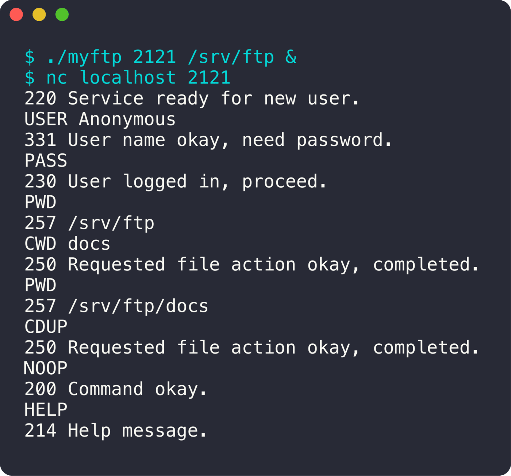

<div align="center">

# myFTP

**Un serveur FTP en C, plusieurs clients à la fois, sans threads.**

   

<sub>Projet solo · 2024</sub>

</div>

<br/>

<p align="center"></p>

## En deux mots

Un serveur FTP qui suit la **RFC 959** pour la partie commandes : connexion, authentification, navigation dans les dossiers. Tous les clients sont gérés dans un seul processus grâce à `select`.

## Ce que ça fait

- Plusieurs clients en même temps, multiplexés avec **`select`**
- Authentification `USER` / `PASS` (compte Anonymous)
- Navigation : `PWD`, `CWD`, `CDUP`
- `NOOP`, `HELP`, `QUIT`
- Codes de réponse conformes à la RFC (`220`, `331`, `230`, `257`, `530`…)
- Le canal de données (`PASV`, `PORT`, `RETR`, `STOR`, `LIST`) est commencé mais pas terminé

## Sous le capot

Un socket d'écoute et un tableau de clients. À chaque tour de `select`, on accepte les nouvelles connexions et on lit les sockets prêts. Chaque client garde son état (utilisateur, authentifié ou non, dossier courant), et les commandes sont aiguillées vers leur handler.

## Lancer le projet

```bash
make
./myftp 2121 /chemin/du/dossier
nc localhost 2121    # puis : USER Anonymous, PASS, PWD, CWD …
```
